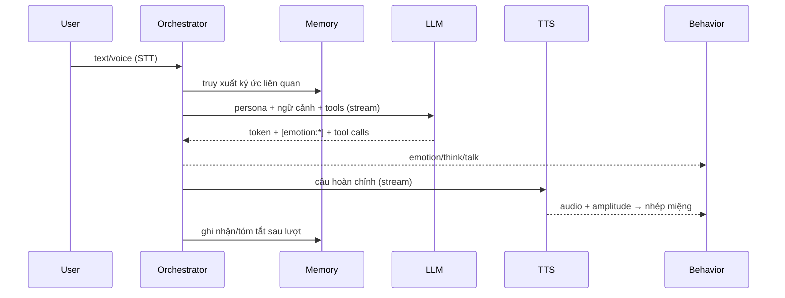
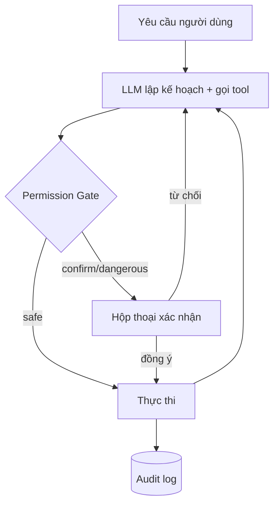

# ARCHITECTURE – DeskPet

## 1. Lựa chọn công nghệ
| Lớp | Chọn | Lý do / phương án thay |
|-----|------|------------------------|
| Desktop shell | **Electron + TypeScript** | Cửa sổ trong suốt, always-on-top, tray, global shortcut; hệ sinh thái Node cho Playwright/MCP. Thay: Tauri (nhẹ hơn, nhưng agent Node phải chạy sidecar). |
| Build | Vite + electron-vite | Hot reload nhanh. |
| Renderer nhân vật | **PixiJS** (WebGL) sau interface `CharacterRenderer` | Sprite-sheet/layered 2D chạy tốt; có thể thêm `Live2DRenderer` (pixi-live2d-display) sau mà không đổi phần còn lại. |
| UI (chat, cài đặt) | React + vanilla CSS | Nhúng trực tiếp vào Pet window (Single Window - ADR 004) để triệt tiêu lỗi DWM frame. |
| LLM | Lớp `LLMProvider` tự định nghĩa; adapter Gemini / OpenAI / Anthropic (SDK chính thức hoặc Vercel AI SDK) | Đổi provider bằng config; hỗ trợ streaming + tool calling. |
| STT | Interface `STTProvider`; ứng viên: Gemini/OpenAI transcribe, Azure/Google Speech (có `vi-VN`) | Chọn bằng benchmark thực tế ở GĐ3. |
| TTS | Interface `TTSProvider`; ứng viên: Gemini TTS, OpenAI TTS, Azure `vi-VN` neural, ElevenLabs | Cần streaming, giọng nữ phù hợp nhân vật. |
| Bộ nhớ | SQLite (`better-sqlite3`) + vector (sqlite-vec) hoặc embeddings lưu cục bộ | Đơn giản, riêng tư, không server. |
| Agent tools | Tool registry nội bộ + **MCP client** (`@modelcontextprotocol/sdk`) | Tận dụng MCP server có sẵn (Calendar, Gmail, Spotify, filesystem). |
| Browser | Playwright (profile riêng) | Tách khỏi trình duyệt chính của người dùng. |
| Computer use | Chụp màn hình (`desktopCapturer`) + điều khiển input (`nut-js` hoặc native addon) | Chỉ bật ở nấc A5. |
| Bí mật | Windows Credential Manager qua `keytar` / `safeStorage` | Không lưu key plaintext. |
| Test | Vitest (logic), Playwright for Electron (E2E nhẹ) | |
| Log | pino → file xoay vòng; audit log riêng | |

## 2. Kiến trúc tổng thể

```mermaid
flowchart LR
  subgraph Electron
    subgraph Main["Main process (Node)"]
      WM[Window Manager]
      BEH[Behavior Engine]
      ORCH[Conversation Orchestrator]
      LLM[LLM Providers]
      VOICE[STT/TTS]
      MEM[Memory Store]
      AG[Agent Runtime]
      PERM[Permission Gate + Audit]
      TOOLS[Tool Registry / MCP / Playwright / Computer-use]
      CFG[Config + Secrets]
    end
    subgraph R1["Renderer: Pet Window (Single Transparent Window)"]
      PIXI[CharacterRenderer (PixiJS Canvas)]
      UI[Chat & Settings (React DOM Overlay)]
    end
  end
  PIXI <-- IPC --> WM
  UI <-- IPC --> ORCH
  UI <-- Dynamic Focus --> WM
  ORCH --> LLM
  ORCH --> MEM
  ORCH --> VOICE
  ORCH --> AG
  AG --> PERM --> TOOLS
  BEH <--> PIXI
  ORCH -->|emotion/speak events| BEH
```

Nguyên tắc: **Main process giữ logic & quyền hạn; renderer chỉ vẽ/hiển thị.** Renderer không được truy cập Node/FS trực tiếp (`contextIsolation: true`, preload hẹp, IPC có schema `zod`).

## 3. Mô-đun & trách nhiệm
```
src/
  main/
    windows/        # pet window, tray, đa màn hình, click-through, native DWM
    behavior/       # state machine, di chuyển, lịch idle (thuần logic, test được)
    conversation/   # orchestrator: prompt, ngữ cảnh, emotion tag parser
    llm/            # LLMProvider + adapters + router
    voice/          # stt/, tts/, vad, audio pipeline
    memory/         # sqlite, embeddings, summarizer, retrieval
    agent/          # loop, planner, tool registry, permission, audit
      tools/        # apps, fs, shell, browser, mcp, computer-use
    config/         # settings, secrets
    ipc/            # kênh + schema
  preload/
  renderer/
    pet/            # PixiJS Canvas + React Chat DOM overlay, lip-sync (Single Window - ADR 004)
  shared/           # types, schema (zod), constants
characters/         # Character Packs
docs/
```

## 4. Character Pack (trọng tâm để đổi nhân vật)
```
characters/<id>/
  character.json      # manifest (xem dưới); mẫu đầy đủ: characters/odette/character.json
  persona.md          # tính cách, cách xưng hô, ví dụ thoại
  ASSET_NOTES.md      # nhật ký & quy trình tạo asset (tái lập)
  master/             # ảnh gốc độ phân giải cao (nguồn, không nạp lúc chạy)
  expr/               # biểu cảm (ảnh toàn thân cùng khung với `base`)
  mouth/              # m0/m1/m2 – vùng miệng để đè lên mọi biểu cảm
  pose/               # frame đã xử lý: <clip>_<n>.png (n bắt đầu từ 1)
  pose/ingredient/    # video/frame thô — KHÔNG commit (.gitignore)
  voice.json          # (tuỳ chọn) provider/voice id ưu tiên
```
`character.json` (rút gọn; bản đầy đủ ở pack Odette):
```json
{
  "id": "odette",
  "name": "Odette",
  "renderer": "sprite",
  "size": { "w": 192, "h": 384 },
  "anchor": { "x": 0.5, "y": 1.0 },
  "base": "master/front_neutral.png",
  "states": {
    "idle":  { "clip": "idle", "fallbackPose": "stand", "motion": "breathe" },
    "walk":  { "clip": "walk", "facing": "right", "mirrorForLeft": true },
    "sit":   { "clip": "sit", "enter": "sit_down", "exit": { "clip": "sit_down", "reverse": true } },
    "react": { "clip": "react", "next": "idle" },
    "talk":  { "clip": "idle", "mouth": "amplitude" }
  },
  "poses": { "stand": "master/front_neutral.png" },
  "clips": {
    "walk": { "pattern": "pose/walk_{n}.png", "count": 12, "fps": 8, "loop": true, "anchor": "feet", "ready": true }
  },
  "expressions": { "neutral": "expr/neutral.png", "happy": "expr/happy.png", "blink": "expr/blink.png" },
  "emotions": { "happy": { "expression": "happy", "motion": "hop" } },
  "mouth": { "closed": "mouth/m0.png", "half": "mouth/m1.png", "open": "mouth/m2.png" }
}
```

### Ngữ nghĩa các trường
| Trường | Ý nghĩa |
|--------|---------|
| `renderer` | `sprite` (hiện tại) \| `layered` \| `live2d` (sau này). |
| `size` | Kích thước khung hiển thị gốc của frame (px, trước khi nhân DPI/scale người dùng). |
| `clips.<tên>` | Chuỗi frame: `pattern` có `{n}` (1..`count`), `fps`, `loop`, `anchor`, `ready`. Clip `ready:false` bị coi như **chưa có** → dùng `fallbackPose`/clip dự phòng. |
| `clips.*.anchor` | Điểm bám khi tráo clip/đặt vị trí: `feet` (giữa đáy chân), `head` (đỉnh đầu – dùng cho `drag`, bám con trỏ), `center`. |
| `states.<tên>` | Trạng thái hành vi → clip. Hỗ trợ `next` (chuyển tiếp khi clip một-lần kết thúc), `enter` (clip chuyển vào), `exit` (`{clip, reverse}` – **phát ngược** để thoát, ví dụ đứng dậy = `sit_down` ngược), `mirrorForLeft` (lật ngang khi quay trái), `mouth: "amplitude"` (nhép theo âm lượng), `motion` (hiệu ứng code bổ sung: `breathe`, `bob`, `hop`, `squash`, `swing`…). |
| `poses` | Ảnh tĩnh dùng làm dự phòng khi clip chưa sẵn sàng. |
| `expressions` | Ảnh biểu cảm toàn thân cùng khung với `base`; `blink` dùng để chớp mắt ngẫu nhiên (3–6 s) khi clip không tự chớp. |
| `emotions` | Ánh xạ thẻ `[emotion:*]` của LLM → `{expression, motion?}`. |
| `mouth` | 3 ảnh miệng, cắt từ ảnh khác biệt so với `neutral`, đặt đè tại vùng miệng (toạ độ do tool sinh ra). |

### Hợp đồng & kiểm tra
- **Tập tối thiểu** để pack hợp lệ: state `idle, walk, dragged, falling, talk, react`; biểu cảm `neutral, happy`; clip `idle` **hoặc** pose `stand`. Thiếu clip → fallback: `poses.stand` + `motion` bằng code. Thiếu state → `idle`.
- Các clip đánh `ready:true` phải có đủ file `pattern` (1..`count`) và cùng kích thước `size`.
- `npm run validate-pack` (làm ở GĐ1) kiểm tra: schema JSON, file tồn tại, kích thước frame, tham chiếu state/emotion → clip/expression hợp lệ, cảnh báo clip `ready:false`.
- Thay đổi schema phải cập nhật đồng thời: `validate-pack`, tài liệu này và pack mẫu (`characters/odette`).

### Quy trình tạo asset 2D bằng AI (khuyến nghị – đã kiểm chứng với Odette)
1. **Master**: tạo ảnh chibi chính diện + nghiêng, nền trong suốt/đơn sắc (`master/`).
2. **Biểu cảm**: sửa ảnh master chỉ ở mặt, giữ nguyên khung/tỉ lệ (`expr/`); miệng m1/m2 tương tự.
3. **Clip chuyển động bằng video**: ảnh khởi đầu nền xanh 9:16 → Flow (Veo) *Frames to Video* (clip lặp: End = Start) → ffmpeg trích frame → colorkey + despill → crop cố định → scale về `size` (`pose/`). Chi tiết lệnh/prompt: `characters/<id>/ASSET_NOTES.md`.
4. **Code bổ sung** (không cần ảnh): lật ngang, phát ngược, nhún/squash, tráo biểu cảm/miệng.
5. Giữ nhất quán: lưu prompt, ảnh tham chiếu, lệnh xử lý trong `ASSET_NOTES.md`.
6. Nâng cấp tuỳ chọn: tách layer (tóc/mắt/miệng) → Live2D/Spine để chuyển động mượt hơn.

> Rủi ro lớn nhất của dự án nằm ở **tính nhất quán asset AI**, không ở code. Chuỗi clip nối nhau (chain) dễ "trôi" thiết kế → luôn đối chiếu với ảnh master.


## 5. Behavior Engine
- State machine thuần (XState hoặc tự viết), đầu vào: tick, sự kiện chuột, sự kiện hội thoại; đầu ra: `{state, velocity, clip}`.
- Vị trí tính theo work area từ `screen.getAllDisplays()`; cập nhật bằng `setBounds` (throttle) hoặc giữ cửa sổ toàn màn hình trong suốt + vẽ nhân vật (cân nhắc ở spike GĐ1).
- Click-through: `setIgnoreMouseEvents(true, {forward:true})`; renderer báo hit-test alpha → main bật/tắt ignore.

## 6. Luồng hội thoại


## 7. Agent & an toàn

- `Tool { name, schema(zod), risk, run(ctx) }`; risk có thể nâng theo tham số (vd. `shell` với `rm`/`del` → dangerous).
- **Allowlist** thư mục/lệnh/domain; cấu hình trong Settings.
- Giới hạn bước & thời gian mỗi tác vụ; kill-switch toàn cục.
- Dữ liệu ngoài (web, file, mail) gắn nhãn `untrusted` trong prompt; không bao giờ coi là chỉ thị.
- Computer use: hiển thị viền/chỉ báo khi đang điều khiển, xác nhận theo từng nhóm hành động.

## 8. Cấu hình & dữ liệu
- `%APPDATA%/DeskPet/`: `config.json`, `memory.db`, `logs/`, `audit.log`, `characters/` (người dùng thêm).
- Secrets chỉ trong credential store.

## 9. Quyết định cần ghi (ADR)
Lưu tại `docs/adr/NNN-*.md` mỗi khi chốt: renderer, cơ chế click-through, nhà cung cấp STT/TTS, vector store, thư viện computer-use.

## 10. Rủi ro chính
| Rủi ro | Giảm thiểu |
|--------|-----------|
| Asset AI thiếu nhất quán | Làm spike sớm, chuẩn hoá character sheet, giữ animation đơn giản |
| Click-through/đa màn hình/DPI lỗi | Spike riêng GĐ1, test nhiều DPI |
| STT/TTS tiếng Việt kém/trễ | Benchmark 2–3 nhà cung cấp, interface thay được |
| Prompt injection khi agent đọc web/mail | Gate + untrusted tagging + confirm |
| Chi phí API | Cache, tóm tắt ngữ cảnh, model nhỏ cho tác vụ phụ, hiển thị mức dùng |
| Computer use sai thao tác | Xác nhận, giới hạn vùng, kill-switch, chỉ bật khi muốn |
