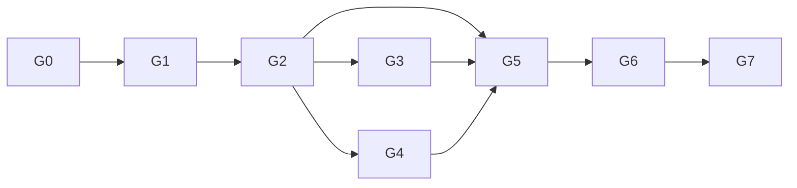

# ROADMAP – DeskPet

Mỗi giai đoạn (GĐ) kết thúc bằng một bản **chạy được, demo được**. Không sang GĐ sau khi tiêu chí hoàn thành chưa đạt.

## GĐ0 – Nền móng & asset (song song)
- [x] Khởi tạo repo: Electron + Vite + TS, lint/format, Vitest, cấu trúc thư mục.
- [x] `AGENTS.md`, ADR đầu tiên, CI cơ bản (lint + test); `.gitignore` bỏ `characters/*/pose/ingredient/`.
- [x] **Spike asset**: quy trình Flow (Veo) video + ffmpeg đã kiểm chứng với walk của Odette (xem `characters/odette/ASSET_NOTES.md`); còn hoàn thiện các clip còn lại.
- [x] Chốt tên + persona nhân vật (Odette).

✅ Xong khi: `npm run dev` mở cửa sổ trống; có ≥ 1 bộ ảnh nhân vật nhất quán.

## GĐ1 – Pet cơ bản (Tầng 1)
- [x] Cửa sổ trong suốt, always-on-top, tray.
- [x] Spike click-through theo pixel + đa màn hình + DPI → ADR.
- [x] `CharacterRenderer` (PixiJS) + loader Character Pack + schema + `validate-pack`.
- [x] Behavior state machine: idle/walk/sit/sleep (có unit test).
- [x] Tương tác: click, double-click, kéo thả, rơi xuống.
- [x] Settings tối thiểu + auto-start.
- [x] Nhân vật thứ 2 (placeholder) để chứng minh đổi pack.

✅ Xong khi: đạt tiêu chí MVP trong SPEC §5.

## GĐ2 – Trò chuyện text (Tầng 2)
- [x] Khung chat nhúng trực tiếp trong Pet window (Single Window - ADR 004) + bong bóng thoại, streaming.
- [x] `LLMProvider` + adapter Gemini (đầu tiên), rồi Deepseek; chọn provider trong Settings.
- [x] Lưu key an toàn.
- [x] Persona từ pack; parser thẻ cảm xúc → animation.
- [x] Quản lý ngữ cảnh (cửa sổ trượt + tóm tắt).
- [x] Xử lý lỗi/offline/giới hạn rate.

✅ Xong khi: trò chuyện tiếng Việt tự nhiên, nhân vật đổi biểu cảm theo nội dung, đổi provider không cần restart.

## GĐ3 – Voice (Tầng 3)
- [ ] Benchmark STT/TTS vi-VN (độ chính xác, độ trễ, giá) → ADR.
- [ ] Push-to-talk global hotkey → STT.
- [ ] TTS streaming theo câu + nhép miệng theo biên độ.
- [ ] Barge-in; VAD; (tuỳ chọn) wake word.
- [ ] Chỉ báo "đang nghe" rõ ràng.

✅ Xong khi: nói → nghe trả lời ≤ 3 s, miệng khớp âm thanh, ngắt lời hoạt động.

## GĐ4 – Bộ nhớ & chủ động (Tầng 4)
- [ ] Memory store (SQLite) + trích xuất ký ức sau hội thoại.
- [ ] Truy xuất ngữ nghĩa đưa vào prompt.
- [ ] UI xem/sửa/xoá ký ức.
- [ ] Scheduler: nhắc việc, hẹn giờ, chủ động bắt chuyện; chế độ Không làm phiền.

✅ Xong khi: bot nhớ thông tin giữa các phiên và nhắc việc đúng giờ.

## GĐ5 – Agent nền tảng
- [ ] Tool registry + schema + risk levels.
- [ ] **Permission Gate**, hộp thoại xác nhận, allowlist, audit log + viewer, kill-switch.
- [ ] Agent loop (giới hạn bước/thời gian), tool calling qua LLM.
- [ ] **A1**: mở/đóng app, mở file/URL, tìm web.
- [ ] **A2**: file đọc/ghi trong thư mục cho phép; shell có allowlist.
- [ ] Test an toàn: prompt injection, lệnh nguy hiểm bị chặn.

✅ Xong khi: ra lệnh bằng text/voice, tác vụ thực thi đúng, hành động nguy hiểm luôn bị hỏi.

## GĐ6 – Agent mở rộng
- [ ] **A3** Playwright (profile riêng, domain allowlist).
- [ ] **A4** MCP client + OAuth; tích hợp lần lượt: Calendar → Gmail → Spotify.
- [ ] Hiển thị tiến độ tác vụ qua hành vi nhân vật (think/work).

## GĐ7 – Computer use (A5)
- [ ] Chụp màn hình → mô hình thị giác → hành động chuột/phím.
- [ ] Giới hạn vùng, chỉ báo đang điều khiển, xác nhận theo nhóm, kill-switch.
- [ ] Bộ kịch bản kiểm thử lặp lại.

## GĐ8 – Hoàn thiện (tuỳ chọn)
- [ ] Nâng cấp renderer Live2D/layered.
- [ ] Marketplace/nhập Character Pack, installer, auto-update.
- [ ] Tối ưu hiệu năng, mở rộng macOS.

## Phụ thuộc chính

## Cách làm việc với Antigravity cho mỗi GĐ
1. Mở `docs/` + `AGENTS.md` làm ngữ cảnh.
2. Yêu cầu agent lập **kế hoạch ngắn** (task list) cho GĐ rồi mới code.
3. Mỗi task nhỏ: code + test + cập nhật tài liệu, commit riêng.
4. Spike rủi ro (click-through, STT/TTS, computer use) → ghi ADR trước khi mở rộng.
